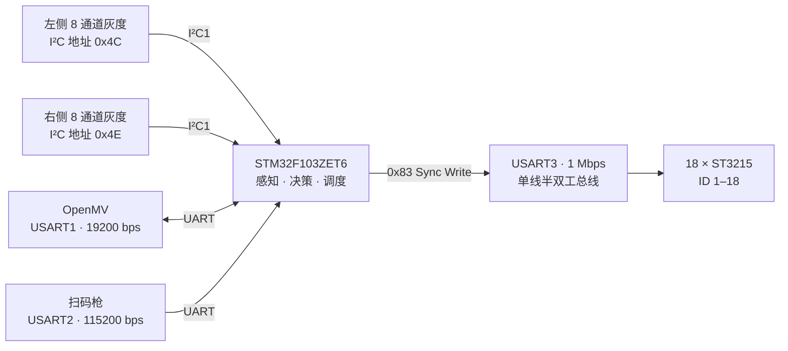
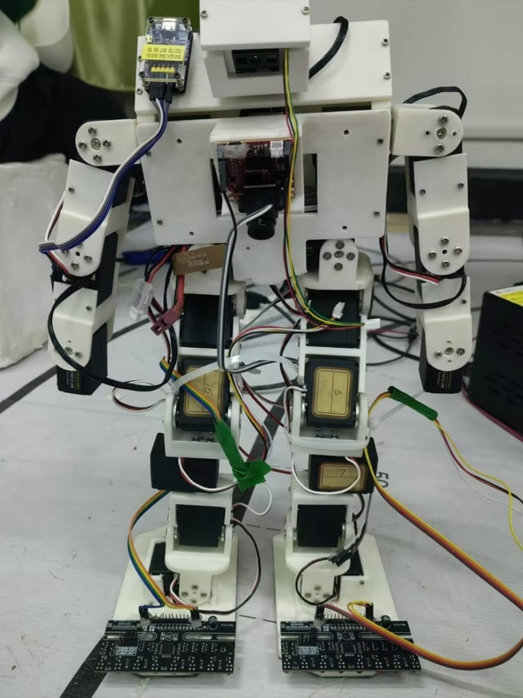
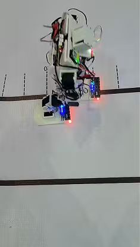
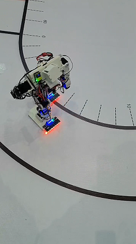
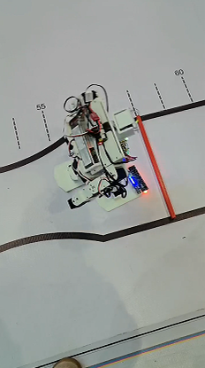

# 智能人形机器人自主巡线控制系统

> STM32F103ZET6 · C · SPL · USART · I²C · ST3215 · OpenMV · 关键帧动作调度

华为终端硬件精英挑战赛 2026 华中赛区决赛项目。本项目面向人形机器人封闭跑道任务，使用 STM32F103ZET6 协调 18 路 ST3215 串行总线舵机、左右两块 8 通道灰度模块、OpenMV 和扫码枪，完成巡线、弯道修正、障碍识别、扫码动作与整圈返回起点测试。

## 项目亮点

- **单总线多关节控制：** 18 个 ST3215 共享 USART3 对应的单线半双工总线，以舵机 ID 1–18 区分节点。
- **同步目标下发：** 使用 `0x83` 广播同步写，一帧下发 18 路关节的 2 字节目标位置；完整帧 62 Byte，在 1 Mbps、UART 8N1 下理论总线占用约 0.62 ms。
- **双路灰度巡线：** 两块 8 通道灰度模块共用 I²C1，通过 `0x4C`、`0x4E` 两个地址读取左右各 8 bit 数字位图。
- **多外设协同：** USART1 接入 OpenMV，USART2 接入扫码枪，结合灰度判决和关键帧动作调度构成“感知—决策—执行”链路。

## 我的工作

队长、嵌入式软件开发，负责：

- STM32 多外设通信与接口联调；
- ST3215 同步写数据帧和关键帧动作调度；
- 双路灰度读取及微调/中调/大调分级修正；
- OpenMV、扫码动作与巡线任务联动；
- 整机步态参数调整和赛道实场测试。

## 系统架构



| MCU 外设 | 连接设备 | 配置/作用 |
|---|---|---|
| USART1 | OpenMV | 19200 bps，接收视觉动作码 |
| USART2 | 扫码枪 | 115200 bps，中断接收扫码数据 |
| USART3 | 18 个 ST3215 | 1 Mbps，共享单线半双工总线 |
| I²C1 | 双路 8 通道灰度模块 | 100 kHz，7 bit 地址 `0x4C` / `0x4E` |

## 关键实现

### 1. 18 路舵机同步写

每个 ST3215 在共享总线上具有独立 ID。控制器使用广播 ID `0xFE` 和同步写指令 `0x83`，将 18 路目标位置放入同一数据帧：

```text
FF FF FE 3A 83 2A 02
│     │  │  │  │  └─ 每个舵机写入 2 Byte 目标位置
│     │  │  │  └──── 目标位置首地址 0x2A
│     │  │  └─────── SYNC WRITE 0x83
│     │  └────────── 长度字段 0x3A = 58
│     └───────────── 广播 ID 0xFE
└────────────────── 帧头

随后为 18 组 [舵机 ID + 位置低字节 + 位置高字节]，最后 1 Byte 校验和。
```

长度字段计算：

```text
Length = (单舵机数据长度 + ID长度) × 舵机数 + 4
       = (2 + 1) × 18 + 4
       = 58 = 0x3A

完整帧长度 = Length + 帧头2 Byte + ID 1 Byte + Length字段1 Byte
           = 58 + 4
           = 62 Byte
```

UART 8N1 每字节在线路上占 10 bit，因此理论线路发送时间为：

```text
62 Byte × 10 bit / 1,000,000 bit/s = 0.62 ms
```

作为对照，如果对 18 个舵机逐个发送仅包含 2 字节位置的普通写帧，理论数据量约为 `18 × 9 = 162 Byte`，线路时间约 1.62 ms。同步写减少了总线数据量以及不同关节接收目标指令的时间差。

> **说明：** 0.62 ms 只表示理想波特率下从首个起始位到末个停止位的理论线路时间，不包含 MCU 组帧、半双工方向切换、舵机协议解析、内部控制周期和机械响应，也不代表实测关节启动误差。

### 2. 双路灰度巡线

左右两块灰度模块共用 I²C1。主控分别读取地址 `0x4C` 和 `0x4E` 的数字模式数据，每块模块返回 1 Byte 位图，每一位对应一路探头的黑白状态。

```text
左侧位图 Digtal_L：bit0 ... bit7
右侧位图 Digtal_R：bit0 ... bit7
                         ↓
          黑线覆盖位置与左右状态判决
                         ↓
             微调 / 中调 / 大调动作码
```

这种设计只占用一条 I²C 总线，通过不同设备地址区分左右模块，并利用两侧检测结果处理直道、弯道和局部丢线场景。

### 3. 关键帧动作与多源任务联动

步态以原始舵机同步写帧保存，动作表记录数据指针、帧长度和帧间延时。`run_action_code()` 将巡线、视觉或扫码产生的动作码映射为关键帧序列，再由 `play_frames()` 依次发送。

```text
灰度 / OpenMV / 扫码数据
          ↓
      动作码判决
          ↓
   run_action_code()
          ↓
     play_frames()
          ↓
  0x83 同步写 → 18 路舵机
```

## 实场测试

| 整机与传感器 | 直道测试 |
|---|---|
|  |  |

| 弯道测试 | 完圈返回起点 |
|---|---|
|  |  |

完成直道、弯道、扫码动作和整圈返回起点的实场联调。项目进入 2026 华为终端硬件精英挑战赛华中赛区决赛；相关原型项目获得 2025 中国机器人大赛人形竞技全能赛全国三等奖。

## 代码索引

```text
firmware/
├─ app/
│  ├─ main.c               # 主循环和任务联动
│  ├─ WalkingControl.c     # 动作帧、动作调度与灰度巡线
│  └─ wiring.c/.h          # 基础时间接口
└─ drivers/
   ├─ openmv_comm.c/.h     # OpenMV UART通信
   ├─ barcode_scanner.c/.h # 扫码枪接收与解析
   ├─ comm_manager.c/.h    # 多来源动作管理
   ├─ gw_grayscale_sensor.*# 灰度模块接口
   └─ spl_i2c.c/.h         # STM32 SPL I²C读写
```

- 主程序入口：[`firmware/app/main.c`](firmware/app/main.c)
- 关键帧调度：[`run_action_code() / play_frames()`](firmware/app/WalkingControl.c)
- 灰度读取与修正：[`gray()`](firmware/app/WalkingControl.c)
- OpenMV 通信：[`firmware/drivers/openmv_comm.c`](firmware/drivers/openmv_comm.c)
- 扫码通信：[`firmware/drivers/barcode_scanner.c`](firmware/drivers/barcode_scanner.c)

## 仓库说明

本仓库是从比赛原始 Keil 工程中整理出的**核心实现展示**，用于说明本人负责的嵌入式软件工作。为避免上传比赛交付包、队友源文件、第三方手册和大体积素材，仓库未包含：

- STM32F1 标准外设库、CMSIS 与启动文件；
- ST3215 厂商完整通信库；
- Keil 工程配置、生成文件和编译产物；
- 机械结构、电路源文件、原始动作调试数据和完整视频。

因此当前仓库不是可直接编译烧录的完整固件。代码保留了部分现场调试痕迹，复现时需要根据实际主控板、舵机参数和传感器安装位置重新核对串口映射、I²C 地址、动作帧和判决阈值。

本仓库未添加开源许可证；其中厂商接口代码的权利归原作者所有。
